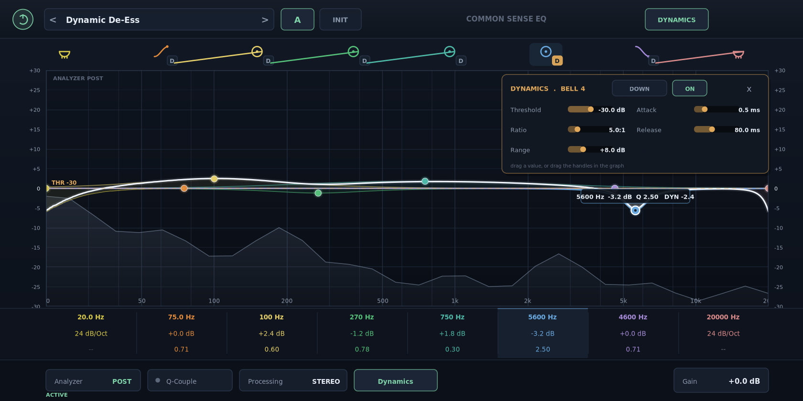
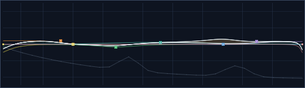
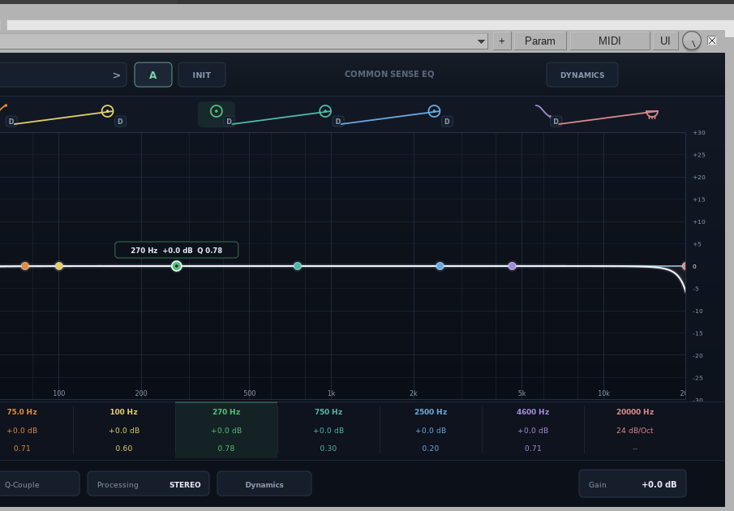

# Common Sense EQ

[](https://github.com/tylorismusic-commits/common-sense-eq/actions/workflows/build.yml)

**Version 0.1.2** · [GitHub](https://github.com/tylorismusic-commits/common-sense-eq) · GPL-3.0-or-later

**Common Sense EQ** is a free, open-source 8-band channel EQ for Linux with
dynamic bands, a spectrum analyzer, and EQ curves in the mixer strip of Ardour
and the track/mixer panels of REAPER.

It follows the layout and workflow of Logic's Channel EQ — eight fixed bands,
coloured band handles, PRE/POST analyzer, Q-Couple, stereo/mono processing and
an output gain — and adds per-band dynamics in the spirit of TDR Nova.



The same curve model is rendered in the host:



Common Sense EQ is an original implementation. It is not affiliated with or
endorsed by Apple, Logic, TDR, or any other manufacturer. The interface is
drawn from scratch in the same visual language; no Apple artwork or presets are
included.

## Features

- **Eight fixed bands** — 6/12/18/24/30 dB-per-octave low cut, low shelf, four
  bells, high shelf, and a 6/12/18/24/30 dB-per-octave high cut. Defaults match the familiar
  channel-EQ layout (20 Hz, 75 Hz, 100 Hz, 270 Hz, 750 Hz, 2.5 kHz, 4.6 kHz,
  20 kHz).
- **Dynamic bands** — every shelf and bell can follow the programme with
  threshold, ratio, attack, release, and range controls. The applied curve,
  the set curve, the reduction ribbon, and the threshold line are all visible.
  A live reduction meter sits in the dynamics panel, each dynamic band column
  shows a GR bar, and both inline views draw the reduction amount. Dynamics
  can attenuate (the default) or lift (UP mode).
- **Analyzer** — 2048-point FFT with PRE/POST taps and a 32-band log display.
- **Q-Couple** — Q follows the band gain when enabled, like the original.
- **Processing modes** — Stereo, Mono, Left, and Right.
- **Output gain** and a master bypass.
- **Presets** — six factory presets (Flat, Vocal Presence, Kick Punch, Air &
  Shine, Dynamic De-Ess, Dynamic Low Control), A/B compare, and INIT.
- **Ardour inline display** — the curve (with live dynamic movement and the
  analyzer) is drawn in the mixer strip through the Harrison inline-display
  extension, even when the editor is closed.
- **REAPER embedded UI** — the curve lives in the TCP or MCP through
  `cockos.reaper_embedui`, and it is interactive: drag nodes, wheel for Q,
  double-click to reset, right-click to enable/disable.
- **Zero latency** — no oversampling, no lookahead, no reported latency.
- **Same editor everywhere** — one Cairo/X11 editor for the LV2 and CLAP
  builds; no duplicated UI code.

## Formats

| Format | Bundle | Host |
| --- | --- | --- |
| LV2 | `common-sense-eq.lv2` | Ardour, Carla, Jalv, any LV2 host |
| CLAP | `CommonSenseEQ.clap` + `CommonSenseEQ.resources/` | REAPER, Bitwig, Qtractor, any CLAP host |

The LV2 build carries the inline display. The CLAP build carries the REAPER
embedded UI. The editor was checked in REAPER 7.84 on Linux; the LV2 bundle and
inline-display extension are covered by the host tests and use the same
Harrison extension as Ardour's own a-eq:



## Building

Prebuilt Linux x86-64 bundles are attached to the
[releases](https://github.com/tylorismusic-commits/common-sense-eq/releases);
building from source is recommended on other distributions.

Requires CMake 3.16+, a C++17 compiler, and the LV2, Cairo, and X11 development
packages. Lilv is optional and only used by the host test.

On Arch Linux:

```sh
sudo pacman -S --needed cmake gcc pkgconf lv2 cairo libx11
cmake -S . -B build -DCMAKE_BUILD_TYPE=Release
cmake --build build -j
ctest --test-dir build --output-on-failure
```

Products:

- `build/lv2/common-sense-eq.lv2/`
- `build/clap/CommonSenseEQ.clap` and `build/clap/CommonSenseEQ.resources/`

Install to the standard user locations:

```sh
cmake --install build --prefix "$HOME/.local"
```

or copy the two bundles into the per-user directories:

```sh
mkdir -p ~/.lv2 ~/.clap
cp -r build/lv2/common-sense-eq.lv2 ~/.lv2/
cp -r build/clap/CommonSenseEQ.clap \
      build/clap/CommonSenseEQ.resources ~/.clap/
```

The parameter table and LV2 metadata are generated from one source:

```sh
python3 tools/gen_params.py
```

This rewrites `src/cse/param_info.hpp`, `lv2/common-sense-eq.ttl`, and
`lv2/manifest.ttl`; commit the results.

Offline previews:

```sh
cmake --build build --target common_sense_eq_ui_preview
./build/common_sense_eq_ui_preview /tmp/common-sense-eq.png 1.5

cmake --build build --target common_sense_eq_inline_preview
./build/common_sense_eq_inline_preview   # writes docs/inline-*.png
```

## Using the inline curves

**Ardour** — insert the LV2 plugin on a track or bus. The mixer strip shows the
curve automatically. The display follows dynamic gain reduction, so it moves
with the music.

**REAPER** — insert the CLAP plugin, right-click the FX in the FX list (or its
title bar) and choose **Show embedded UI in TCP** or **Show embedded UI in
MCP**. In the embedded view:

- drag a node to change frequency and gain
- wheel over the view to change Q
- double-click a node to reset its gain
- right-click near a band to enable or disable it

## Controls

| Action | Result |
| --- | --- |
| Click a band icon | Enable/disable that band |
| Click the small **D** badge | Toggle that band's dynamics and open the panel |
| Drag a node | Frequency and gain |
| Wheel over the graph | Q of the nearest band |
| Wheel over a bottom value | Frequency, gain, or Q |
| Shift-drag / Shift-wheel | Fine adjustment |
| Double-click a node | Reset gain (or frequency for cuts) |
| Right-click near a band | Select it and open its dynamics |
| Drag a bottom-strip value | Frequency, gain, or Q |
| Click a cut band's slope row | Cycle 6 → 12 → 18 → 24 → 30 dB/oct |
| Wheel a cut band (icon, node, or column) | Change its slope |
| Click **Analyzer** | PRE/POST |
| Click **Q-Couple** | Couple Q to gain |
| Click **Processing** | Stereo → Mono → Left → Right |
| Click **DYNAMICS** | Open the selected band's dynamic panel |
| A/B | Compare two parameter sets |
| INIT | Reset to the default flat EQ |

## Design notes

- Bells use a topology-preserving SVF, so the dynamic gain can move every
  sample without recomputing the filter. Shelves and cuts use RBJ biquads,
  refreshed every 16 samples while the smoothers run per sample.
- Every band is exactly transparent at 0 dB (shelves collapse to an identity
  filter), so a flat EQ adds neither gain nor phase.
- Dynamic detection is stereo-linked and fed from the signal entering the band.
  The band-pass detector is Q-normalised so changing a band's Q does not change
  its threshold behaviour.
- The LV2 DSP publishes its display state through a seqlock; the inline
  renderer is a small dependency-free ARGB rasteriser, so Ardour never needs
  Cairo or the editor to show the curve.
- The editor renders at 1120×560 logical units and scales to whatever the host
  gives it, with letterboxing to preserve the layout.

## Tests

```sh
ctest --test-dir build --output-on-failure
```

The suite covers flat transparency, analytic-vs-measured bell and cut
responses, dynamic triggering and release, extreme-setting stability, the
analyzer, LV2 bundle loading and inline rendering, CLAP parameter/state/embedded
UI messages, and a live X11 editor test under Xvfb.

## Known limits

- No linear-phase mode (the second Logic reference). The band model and
  response code are engine-agnostic, so it can be added later.
- Dynamics are available on shelves and bells, not on the low/high cuts.
- No external sidechain or undo history yet.
- A/B state is per editor session and is not stored in the plugin state.
- The embedded REAPER view supports node dragging, wheel Q, double-click reset,
  and right-click enable; it does not show a context menu.

User presets are stored in `~/.config/CommonSenseEQ/presets` and can be
exported to `~/Documents/Common Sense EQ Presets`; drag a preset file onto the
panel to import it.

## License

GPL-3.0-or-later. See `LICENSE`.
